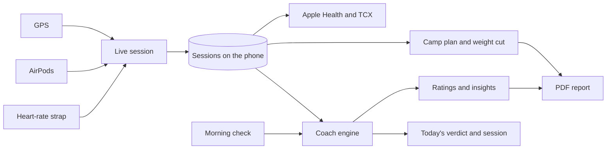

<p align="center">
  
</p>

<p align="center">
  <a href="https://github.com/drivepulator/FIGHT/actions/workflows/build.yml"></a>
  
  
</p>

<p align="center">
  <a href="#install">Install</a> ·
  <a href="#train">Train</a> ·
  <a href="#know-where-you-stand">Coaching</a> ·
  <a href="#fight-camp">Fight camp</a> ·
  <a href="#gear">Gear</a> ·
  <a href="docs/METHODOLOGY.md">Methodology</a>
</p>

FIGHT is an iPhone app for Muay Thai, kickboxing, boxing, MMA and grappling. Put on a heart-rate strap, pick what you're training, and it runs the round clock, calls your combos, tracks your roadwork and tells you each morning whether to go hard, go easy or rest. Everything is worked out on your phone from your own numbers.

No account. No subscription. No server.

## Built for how fighters train

Most fitness apps are made for runners and gym-goers. Fighters train in rounds, recover on the stool, cut weight and peak for one night. FIGHT is built around that.

| In camp you ask | FIGHT answers with |
|---|---|
| Am I recovered enough to spar today? | A morning verdict from your training load, heart-rate variability, resting heart rate, sleep and soreness |
| Is my gas tank getting better? | How fast your heart rate climbs round after round, and how quickly it drops on the stool |
| Can I go five rounds? | A projection for 3×2, 3×3 and 5×3 that names the round where you'd redline |
| What should I do today? | One session, ready to start: rounds, rest and the heart-rate band to stay in |
| Am I on track to make weight? | Your weigh-in trend against fight night, with warnings when the cut gets unsafe |
| How do I show my coach? | A two-page PDF report, or a plan file your coach sends and you send back with results |

## Train

Every session starts from one of three buttons. Pick the button, pick the session, pick how long, press Start.

| | What you can choose |
|---|---|
| **Fight** | Your sport, then bag work, pads (mitts for boxers), shadowboxing, clinch, sparring or technique. Grapplers get drilling, positional and rolling. Round lengths follow your fight format. |
| **Roadwork** | Easy run, fight-rounds run, sprints, hill sprints or a recovery walk. GPS tracks distance, pace and splits. |
| **Conditioning** | Plyometrics, jump rope, circuits, a custom mix, training plans or the 30-minute fitness test that sets your zones. |

The last session you did, or today's suggestion from the coach, sits underneath as a single **Go again** button.

### In the round

- **Round bell and corner timer.** Gym bell, 10-second clapper, "final round" call and a triple bell at the end. Haptics on every bell.
- **A coach on the bag.** Combinations called out loud for your stance and level, timed so you finish one before the next is called. Five tempos from technical to burnout. Only the strikes your sport uses.
- **Corner coach.** Tells you to pick it up when your pace drops below your own first round, and to breathe when you've been redlining too long. One call at a time, never more than one every 45 seconds.
- **Gloves-on control.** End the round or start the next one from the Lock Screen, by nodding on the stool with AirPods in, or with Siri.
- **AirPods awareness.** Counts slips and rolls per round, reminds you to move your head and keep your chin down, and finds the heart rate where your defence starts to fall apart.
- **Bag hits.** The phone's microphone counts the shots you land, and ignores the coach's own voice.
- **Nothing lost.** The session saves itself every 30 seconds. If the app closes mid-round, it offers to recover it.

### Roadwork

- Big, glanceable numbers while you run: distance, pace, moving time and heart rate. Also on the Lock Screen and Dynamic Island.
- A spoken split every kilometre (or mile), and auto-pause when you stop at a light.
- After the run: your route on a map coloured by pace, splits with your fastest highlighted, elevation, time in Zone 2 and heart-rate drift.
- Uses the best position source it can find. A Bluetooth GPS receiver comes first, then receivers like Garmin GLO and Bad Elf through iOS, then the iPhone itself. A foot pod keeps distance going when GPS drops under trees or between buildings.
- Distance and route are saved to Apple Health, so the run appears on a map in Fitness and can sync on to Strava from there.

### Conditioning

Four plyometric sessions written for fighters:

| Session | What it builds |
|---|---|
| **Fight Power** | Leg drive for kicks and entries: box or squat jumps, broad jumps, skater bounds, split-stance switches |
| **Punch Power** | Rotation and upper body: medicine-ball passes, throws and slams, or explosive push-ups and band punches without the gear |
| **Fast Feet** | Pogo, in-out and lateral hops, then a reaction game where the coach calls the direction |
| **Plyo Rounds** | 20/10 bursts in your fight format. The hard one. |

Before you start, tick the gear you brought and the session swaps exercises to match. Volume stays under a safe number of landings for your level, rests end as soon as your heart rate has come down, and with AirPods in the app measures each jump and stops the set when your height drops off.

## Know where you stand

- **Today.** One line every morning: train hard, go easy, or rest. The suggested session is ready to start.
- **Morning check.** Two minutes sitting still with your strap on gives resting heart rate and heart-rate variability. Add sleep (pulled from Apple Health), soreness by body area and an optional three-jump test with AirPods.
- **Fight fitness ratings.** Aerobic base, anaerobic power, fight stamina and recovery speed, each graded with a four-week trend, the evidence behind it and what to do about it.
- **Gas tank.** Projects whether you're ready for 3×2, 3×3 or 5×3, and names the round you'd redline in.
- **Combo cost.** Measures what each combination costs you in heart rate. "Kicks cost you 2.1× the heart rate of punch combos."
- **The FIGHT benchmark.** The same 5 × 3 min test every four weeks, so a lower heart rate means you're actually fitter.
- **A review after every session.** Did the session match its purpose, how even were your rounds, how well did you recover between them, and what to change next time.
- **What drives your performance.** Finds your own patterns: sleep, back-to-back hard days, time of day, sparring partners.

<details>
<summary>The full list of ratings and how they're built</summary>

| Rating | Built from |
|---|---|
| Readiness | Training form, heart-rate variability trend against your normal range, resting heart rate, sleep, soreness, jump test, hours since your last hard session |
| Aerobic base | Weekly easy volume, heart-rate drift on steady runs, aerobic threshold, resting heart rate |
| Anaerobic power | High-intensity volume, peak percentage of max, fastest 20-second heart-rate surge |
| Fight stamina | Heart-rate climb from early to late rounds, drift on long sessions, rounds per session |
| Recovery speed | 60-second stool recovery, how well it holds up in late rounds, heart-rate variability trend |
| Consistency | Sessions per week, active weeks |
| Load balance | Acute-to-chronic workload ratio, training monotony |
| Intensity mix | Easy, tempo and hard time against a polarised model for fighters |

Your effort rating after each session is blended into training load, because heart rate alone under-reads sparring, clinch and strength work. Sessions without a strap are counted by effort alone, and never judged on heart rate they didn't record.

</details>

## Fight camp

- **Camp plan.** Set the fight date and camp length and get weekly targets counted back from fight night: base, build, peak and taper, with deload weeks.
- **Weight cut.** Daily weigh-ins (typed in or from a smart scale through Apple Health), the rate you need, and a projection for the scales. Warnings for drops that are too fast, dark urine, and resting heart rate rising while weight falls.
- **Fight week.** A rehydration guide sized to your cut, and a warm-up that finishes on your walkout time.
- **This camp against the last one.** Weekly load lined up by weeks out, so you know if you're ahead or behind.
- **Report for your coach.** A two-page PDF with ratings, sessions, camp progress, weight and anything that needs attention.

### Plans from your coach

Coaches build sessions out of blocks (bag rounds limited to the combos they choose, drills, intervals, roadwork, strength, rest) and send them as a file, a link or a QR code on the gym wall. Targets are set in zones, so one plan fits the whole team. Fighters run it with a guided countdown and send back a results file with every block's heart rate, time on target and effort rating.

## Share your work

Story stickers for Instagram, built from your real numbers: a broadcast-style session card, a fight poster, your fighter card, a new record, a fight countdown, and for runs your route, your splits or a roadwork card. Put them over your own photo or video. Switches hide your name and weight.

## Gear

**Heart rate.** Any Bluetooth heart-rate monitor works: chest straps, armbands and most sports watches in broadcast mode.

| Sensor | Examples | Rounds and zones | Morning heart-rate variability | Threshold detection while training |
|---|---|:---:|:---:|:---:|
| Chest strap | Polar H10, Garmin HRM-Pro, Wahoo TICKR | Yes | Yes | Yes |
| Optical armband | Polar Verity Sense, Scosche Rhythm, Coospo | Yes | If it sends beat-to-beat data | Often too noisy |
| Watch broadcasting heart rate | Garmin, Polar, Coros, Suunto | Yes | Varies | Rarely |

For the most accurate morning check and threshold detection, use a chest strap. Apple Watch needs a third-party broadcast app to share its heart rate.

**AirPods** (Pro, 3rd generation and later, Max) add head movement, chin position, footwork bounce, nod-to-start and jump height.

**GPS.** iPhone GPS works on its own. Bluetooth GPS receivers, plug-in receivers like Garmin GLO and Bad Elf, and foot pods are used automatically when they're on. Garmin watches don't share their GPS with other iPhone apps; sync those runs through Apple Health instead.

## Your data stays yours

- No account, no server, no analytics, no ads.
- Sessions, check-ins and weigh-ins are stored on your iPhone, in a folder you can open in the Files app.
- Data only leaves the phone when you send it: Apple Health, a TCX file, the PDF report, a story sticker or a backup.
- Shared run routes leave off the first and last 200 m by default, so a sticker doesn't show where you live or train.
- Plans from links, QR codes and files are checked before they open: sizes and values are capped, and only https video links are allowed.
- If a data file is ever damaged, FIGHT keeps a copy of it and tells you, instead of starting over.

## Install

No Mac needed. Every change is built in the cloud.

1. Open the [latest build](https://github.com/drivepulator/FIGHT/actions/workflows/build.yml) and download the **FIGHT-IPA** file.
2. Unzip it to get `FIGHT.ipa`.
3. Install it with [Sideloadly](https://sideloadly.io/) on Windows or macOS, using your Apple ID.
4. On the iPhone, go to **Settings › General › VPN & Device Management** and trust your Apple ID. Turn on **Developer Mode** if asked.
5. Open FIGHT. The one-minute setup asks about you, your sport, your gear and your goal.

With a free Apple ID, the app needs reinstalling every 7 days (your data is kept) and uses two of your three app slots. Apple Health access depends on how the app is signed; everything else works either way.

## For developers

<details>
<summary>Build from source</summary>

On a Mac with Xcode 15 or later:

```bash
brew install xcodegen
git clone https://github.com/drivepulator/FIGHT.git
cd FIGHT
xcodegen generate
open FIGHT.xcodeproj
```

Set your signing team on both targets (`FIGHT` and `FIGHTWidget`), turn on the HealthKit capability and run on a device. Bluetooth isn't available in the simulator.

The cloud build in [`.github/workflows/build.yml`](.github/workflows/build.yml) generates the project, runs the unit tests on an iOS simulator, builds an unsigned release, checks the required `Info.plist` keys, signs it ad hoc with the HealthKit entitlement and uploads the IPA.

The `Info.plist` files in `Sources/` are the source of truth. `project.yml` deliberately has no XcodeGen `info:` blocks, because those would overwrite the plists.

</details>

<details>
<summary>How the analysis works</summary>

Every number is computed on the device from your own data, using established sports-science models: Banister's fitness-fatigue model, TRIMP, the acute-to-chronic workload ratio, Foster's monotony, RMSSD heart-rate variability with a 7-day trend against a 60-day normal range, and DFA α1 for the aerobic threshold. Ratings compare your last 28 days with the 28 days before.

Formulas, thresholds and references are in [`docs/METHODOLOGY.md`](docs/METHODOLOGY.md).



</details>

<details>
<summary>Project layout</summary>

```
FIGHT/
├── project.yml                  XcodeGen spec: app, Live Activity widget, tests
├── .github/workflows/build.yml  Cloud build and tests
├── docs/                        Methodology and artwork
├── Tests/FIGHTTests/            Unit tests for the analysis engines
└── Sources/
    ├── PlanKit/                 Shared plan format: strikes, plans, results, file, link and QR transfer
    ├── Shared/                  Live Activity attributes shared with the widget
    ├── Widget/                  Lock Screen and Dynamic Island
    └── App/
        ├── WorkoutMenu.swift            The three buttons and every session behind them
        ├── WorkoutSession.swift         Live session: clock, rounds, autosave, saving
        ├── BLEHeartRateManager.swift    Bluetooth heart-rate monitors
        ├── AudioCoachEngine.swift       Voice, bells and combo calling
        ├── BagCoach.swift               Strikes, stances and combo selection
        ├── Encouragement.swift          Corner-coach cues
        ├── HeadMotionTracker.swift      AirPods head movement, nods and jump height
        ├── RunTracker.swift             GPS, Bluetooth GPS receivers and foot pods
        ├── RouteMath.swift              GPS filtering, auto-pause, splits, route simplification
        ├── Plyo.swift                   Plyometric sessions, Mix and plyo scheduling
        ├── CoachEngine.swift            Ratings, readiness, load, suggestions, reviews
        ├── Insights.swift               Gas tank, combo cost, benchmark, records, round detection
        ├── HRVMath.swift                Beat-to-beat cleaning, RMSSD, DFA α1
        ├── CampPlanner.swift            Camp periodisation and weight cut
        ├── StoryShare.swift             Instagram story stickers
        ├── WorkoutStore.swift           On-device storage, archives, TCX
        ├── HealthKitManager.swift       Apple Health
        └── …                            Screens and supporting views
```

</details>

## Roadmap

- **FIGHT Coach.** A companion app for coaches: roster, plan assignment and compliance, built on the shared plan format.
- **Fight log.** Compare fight-night heart rate with training.
- **Sparring video** synced to the heart-rate trace.
- **Two sensors at once**, such as an armband and a chest strap, for accurate variability in hard rounds.

Have an idea that would help fighters train smarter? [Open an issue](https://github.com/drivepulator/FIGHT/issues).

## Disclaimer

FIGHT gives training estimates from heart-rate and motion data. It is not a medical device and doesn't give medical advice. Cutting weight and dehydrating carry serious health risks. Work with a qualified coach, doctor or sports dietitian, and follow your commission's rules. Stop and get medical help if you feel unwell.

Product names are trademarks of their owners. FIGHT is an independent project and isn't affiliated with any of them.
